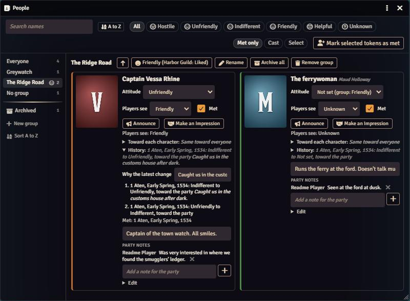
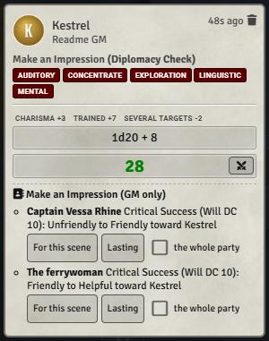
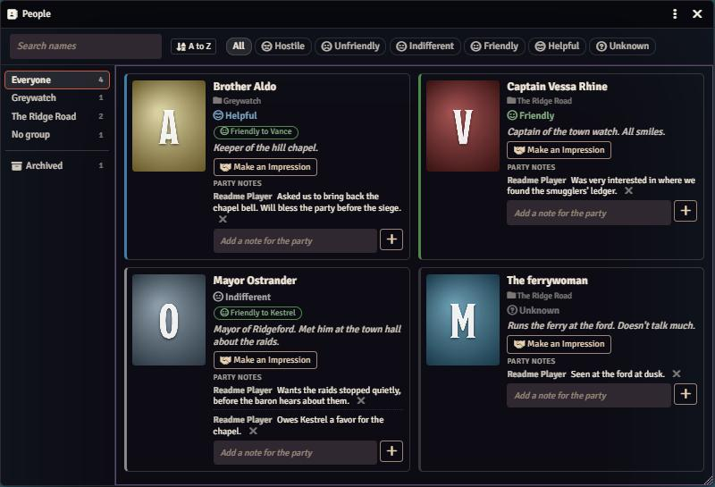

# PF2e NPC Attitudes

Tracks how the people the party has met feel about them. The GM sets each NPC's attitude, from Hostile to Helpful, marks who the party has met, sorts them into groups and applies the results of Make an Impression. Players get a People window with portraits, the name they know each NPC by, their attitude and shared party notes.

## What it looks like



**The GM's view of one group.** Groups down the side; the open group's bar with its own attitude (this one follows a Campaign Trackers reputation), Rename, Archive all and Remove group. Each card holds the NPC's real attitude and what the players are shown, the latest change in its history, and the party's notes, with the rest folded under Edit.



**Make an Impression.** One roll through the system's own action against two NPCs; the GM's card shows each result against that NPC's Will DC and applies it for this scene or for good.



**The players' People window.** The same groups, the names the party knows, the attitudes they've been shown, and notes the whole party can add to. NPCs the GM has archived wait under Archived.

## Install

In Foundry, go to **Add-on Modules**, then **Install Module**, and paste this into **Manifest URL**:

```
https://github.com/Sir-Bayard/pf2e-npc-attitudes/releases/latest/download/module.json
```

Foundry's **Update** button then picks up each new release. You can also download `module.zip` from the [latest release](https://github.com/Sir-Bayard/pf2e-npc-attitudes/releases/latest) and unzip it into `Data/modules/pf2e-npc-attitudes`.

Requires Foundry VTT 14 (verified on 14.370) and the Pathfinder 2e system 8.0.0 or later (verified on 8.7.0). PF2e Campaign Trackers is optional: with it, a group can follow one of its reputations.

Updating keeps attitudes, groups and notes.

## What it does

It uses the system's five attitudes: Hostile, Unfriendly, Indifferent, Friendly and Helpful (their names come from the PF2e system, in its language). Players get a People window: portrait, the name they know the NPC by, the attitude, a one-line description, and shared party notes they can add to. As the cast grows, the GM sorts NPCs into groups, gives a group an attitude of its own, and archives the ones who have left the story, so their attitude is still on record when they come back.

The module reads its rules data from the PF2e system (the attitude names, the Make an Impression action and the names of the degrees of success) and stores no rules tables of its own; the only rules numbers in its code are what each degree of Make an Impression does, its -2 and its five targets. After a system update the attitude names or Make an Impression may be unreadable until the module is updated; the GM is told if so.

## Opening it

- The address-book icon at the bottom of the token controls on the left.
- **Alt+P** (change it in Configure Controls). It opens the window with focus in it, so the keyboard works there at once.
- On a token's HUD (GM only): the address-book button opens the window on that NPC's card.
- The macros in the **People: macros** compendium, or `game.modules.get("pf2e-npc-attitudes").api.open()`.

The window remembers its size and place, in each browser, for each world and user.

## For the GM

- **Mark people as met** in any of three ways:
  - select their tokens and click **Mark selected tokens as met** (when you have groups, it asks which one to put them in);
  - right-click an NPC in the Actors sidebar and choose **People: met / not met**;
  - turn off the **Met only** chip: the NPCs the party hasn't met are listed below the cards, one line each, with a **Met** box and **Card** to open the whole card.

  Marking from a token whose name differs from the prototype token name fills in "Known as" with the token's name.
- **Chips**: **Met only** hides NPCs the party hasn't met. **Cast** shows only actors your campaign module marks as Cast; it appears once you list that module's id in the "Cast flag scopes" setting, and any actor with `flags.<id>.cast` set counts. **Select** puts a tick box on each card for changing several at once (below). The chips are remembered in this browser, for each world and user.
- **Attitude** is the NPC's real attitude. **Players see** is what the party is shown: the same, a different attitude (someone hiding how they feel), or Unknown. The GM sees both. An NPC whose attitude is Not set takes its group's attitude, when the group has one.
- Setting Hostile when the NPC has tokens on the current scene that aren't Hostile asks whether to set those tokens' disposition to Hostile; Friendly or Helpful asks the same for Friendly. Nothing changes unless you say yes.
- **Toward each character** sets how the NPC feels about one character in particular, when it differs from their general attitude: Unfriendly to Vance but Helpful to Kestrel. Leave a character on "As above" to use the general attitude. Players see these as small tags under the attitude, but only while "Players see" is "The same"; an NPC hiding how they feel shows the players nothing about individual characters either.
- **History** lists every change of attitude, newest first, with the in-game date (from Calendaria when it's on), toward whom, and a reason when there is one. Write the reason for the latest change in the box under it. The date the party first met them is there too.
- The one-line description is shown to players. Use it for who they are and where the party met them.
- **Edit** opens the rest: the Group menu, Known as and **Reveal name**, the portrait, and **Archive**.
- Click a portrait to open the NPC's sheet. Drag it onto the sidebar to move the NPC (see below), or use the Group menu and Archive under Edit.
- **Changing several at once**: turn on **Select**, tick cards (or **Tick all shown**), then put them in a group, mark them met, archive them or bring them back.

## Make an Impression

A **Make an Impression** button on each card the party has met rolls the system's own Make an Impression (a Diplomacy check against the target's Will DC), so the character's own modifiers and the system's roll dialog apply.

- Pick who rolls and up to five targets; with more than one, the system's roll gets a -2. One roll gives a result for each target against that NPC's own Will DC. Add a situation modifier in the dialog, or in the system's roll dialog when it's on.
- It's for conversation outside an encounter: the target has to hear and understand the character.
- The chat card gets an **Apply** panel that only the GM sees: for each target, the result and what applying it would do. A critical success makes the attitude two steps better, a success one, a failure changes nothing, and a critical failure makes it one step worse, stopping at Helpful and Hostile. An attitude that's Not set counts as Indifferent.
- The change is toward the character who rolled, unless you tick **the whole party**. **For this scene** keeps it apart from the stored attitude and starts from the attitude as it stands; the card shows it, players see it, and **Clear** puts things back (a macro clears every NPC's). **Lasting** starts from the stored attitude, changes it and adds a line to its history. When the two differ, the panel shows both. Each result can be applied once, also across a Hero Point reroll of the same roll, so apply it after any reroll.
- Players get the button on their own cards, for characters they own, when the GM turns on "Players can Make an Impression" in the settings. The GM still applies every result, and the panel appears only on cards from the system's own Make an Impression, rolled by a GM or by a player who owns the character. Like every roll in Foundry, the roll itself is made in the roller's own client.

The module doesn't reproduce the action's text; open the action in the system's compendium for the full rules.

## Groups and the archive

The sidebar on the left lists **Everyone** (everyone not archived), each of your groups with how many are in it, **No group**, and **Archived** at the bottom.

- **Groups**: one per NPC, named by you: a place, an arc, a faction ("Greywatch", "The Ridge Road"). Pick it from a card's Group menu, which lists your groups and New group... to make one, or drag the card's portrait onto a group in the sidebar. **New group** adds an empty one. Drag a group up or down the list to move it, use **Move up** and **Move down** with the group open, or click **Sort A to Z**.
- **Archive** an NPC who has left the story (Archive under Edit, or drag them onto Archived). Their attitude, per-character attitudes and notes are kept; **Bring back** (or dragging them onto Everyone, a group or No group) returns them to the lists.
- With a group open, the bar above its cards has **Group attitude** (below), **Rename** (everyone in it follows; renaming to a group you already have merges the two, after asking), **Archive all** (its tooltip says if some of the group are hidden by your chips; it reaches them too), **Bring back** for its archived people, and **Remove group** (its people keep their records, with no group).
- The search box looks everywhere, the archive included; a card found that way shows its group and whether it's archived.
- The button beside the search box sorts **A to Z** or by who was met most recently (**Recent**). The window remembers the sort and the group you were looking at, in each browser.

Players see the same sidebar, built only from the NPCs they've met: a group with nobody they've met doesn't appear for them, so a group can be set up ahead of time. Name groups as the party would know them, since players see the names.

### A group's own attitude

**Group attitude** gives a group an attitude that its members whose own attitude is Not set take (a member with an attitude of their own keeps it). The card shows "Not set (group: Friendly)", and players see the group's attitude.

With PF2e Campaign Trackers on, a group can also **follow a reputation** from its Reputation tab. The reputation's current tier then gives the attitude: each tier gets an attitude, first guessed by its place (the lowest tier Hostile, the highest Helpful, the rest between), and you can change any of them. When the reputation moves to another tier, the attitude follows, for players too (the GM's client tells theirs, so a GM has to be logged in for players to see a change). Without Campaign Trackers, or when the reputation is gone, the group's own attitude is used, and the link and its tiers are kept for when it's back.

## Names and portraits

Players see the "Known as" name; when it is empty, the actor's prototype token name. **Reveal name** (under Edit) sets it to the actor's real name. The actor's own name is shown to the GM only, in small gray type beside it.

Players see the "Portrait" image. When it is empty: the actor image, but if that is art shipped with the system, a Paizo content or token module, or Foundry's own icons (which can give away what the creature is), the prototype token image instead. When that is shipped art too, players see that art, or a silhouette if you choose "Show a silhouette" in the setting "When the only art is shipped art". Pick a portrait with the image button or type a path. The image's alt text is the known name, so a file named after the real person doesn't show up as a tooltip.

## Announcements

Nothing is posted to chat on its own. The Announce button on a GM card posts what the players see of that NPC (name, attitude, per-character tags, the one-line description). The "Announce to" setting says where it goes: everyone, whispered to the GM, or nobody (the button then does nothing).

## Party notes

Notes are a list of short entries, each with who wrote it, newest last. Any player can add an entry and remove their own; the GM can remove any. A player's entry is saved through the GM's client, so a GM has to be logged in, and it is always signed with the name of the player who sent it. One note holds up to 500 characters, and each NPC holds up to 40 notes or 4,000 characters in all: when that's full, a new note is turned down with the reason until someone removes one, and the text stays in the box. Each player can add one note every two seconds.

## Keyboard

Every button, menu and fold in the window works from the keyboard, with a visible focus outline. While focus is in the window, its keys stay there: Space doesn't pause the game, the arrows don't move the map, and Tab moves around the window. Click the map to give the keys back. The two things done by dragging have keyboard ways too: the Group menu and Archive under Edit move an NPC, and Move up and Move down move a group.

## Settings

- **Announce to**: where the Announce button posts.
- **Players can Make an Impression**: gives players the button on their own cards.
- **When the only art is shipped art**: show that art, or a silhouette.
- **Cast flag scopes**: the module ids whose `flags.<id>.cast` marks an actor as Cast.

## What players can read

The real attitude and the "Players see" value live in the actor's flags, which Foundry sends to every client. The window and the API only show players the shown attitude, but a player who reads the actor in the console can see the real one. Treat "Players see" as a courtesy, not a secret. The same goes for the list of groups and their attitudes (world settings), which include groups the party hasn't met anyone from yet. A player who owns an NPC (one lent to them for a fight, say) can't keep a change they make to its record from the console: the GM's client puts it back and tells the GM. A change made while no GM is logged in is kept.

## Macros and the API

The **People: macros** compendium has macros to open the window, mark the selected tokens as met, reveal the selected tokens' real names, and clear every scene-only attitude (on every NPC, wherever it was set). Drag them to the hotbar.

Everything is also under `game.modules.get("pf2e-npc-attitudes").api`. Functions that change records are GM only.

- `open()`, `openOn(actor)`: open the window, or open it on one NPC's card.
- `record(actor)`: the GM gets the whole record; a player gets what players are shown, or `{ met: false }` for an NPC they haven't met.
- `markMet(actor, met)`, `markSelected({ group })`: mark one NPC, or the selected tokens' NPCs (leave `group` out to keep each one's group, `""` for none).
- `setAttitude(actor, id, { shown, why })`, `setTowards(actor, characterId, id, { why })`: the attitude toward the party or one character (`id` "hostile" to "helpful", or `""` for Not set), with an optional reason for the history.
- `setSceneAttitude(actor, characterId, id)`, `clearScene(actor)`: an attitude for this scene only (`characterId` null for the party); `clearScene()` with no actor clears every NPC's.
- `history(actor)`: the attitude changes (GM only).
- `makeImpression(actor)`: open the Make an Impression dialog with that NPC ticked.
- `setKnownAs(actor, "Brother Anselm")`, `reveal(actor)`, `revealSelected()`, `knownName(actor)`: the name players see.
- `announce(actor)`, `addNote(actor, text)`.
- Groups: `groups()`, `setGroup(actor, "Greywatch")`, `setArchived(actor, true)`, `addGroup(name)`, `renameGroup(from, to)`, `removeGroup(name)`, `archiveGroup(name, archived)`, `moveGroup(name, target, after)`, `sortGroups()`, `groupAttitude(name)`, `setGroupAttitude(name, { attitude, tracker, tiers })` (`null` clears it).

## Where the data lives

On each NPC actor, in `flags.pf2e-npc-attitudes.npc` (its attitudes, group, archive, notes, history and this scene's attitudes). Unlinked NPCs keep it on the actor in the sidebar, not on individual tokens. The order of the groups is the world setting `pf2e-npc-attitudes.groups`, and each group's attitude is in `pf2e-npc-attitudes.groupInfo`.

## Languages

All the module's text is in `lang/en.json`; a translation can be added the usual way. The attitude names and the degrees of success come from the PF2e system, in its language.

## Changes

See [CHANGELOG.md](CHANGELOG.md).

## How it was made

This module was written with Claude, Anthropic's AI assistant, directed and tested by its author at a real table. It is shared as is, for free.

## Problems and suggestions

Open an [issue](https://github.com/Sir-Bayard/pf2e-npc-attitudes/issues).

## License

[MIT](LICENSE). Copyright (c) 2026 Sir Bayard.

## Pathfinder

PF2e NPC Attitudes is an unofficial, free module for the Pathfinder Second Edition system on Foundry VTT. It is not published, endorsed or specifically approved by Paizo Inc. Pathfinder is a trademark of Paizo Inc., used here only to say which game the module works with. The module follows the game's rules, which Paizo publishes under the ORC License, and refers to them by name; it doesn't reproduce Paizo's rules text, art or setting material.
