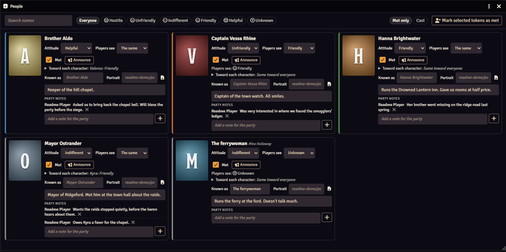
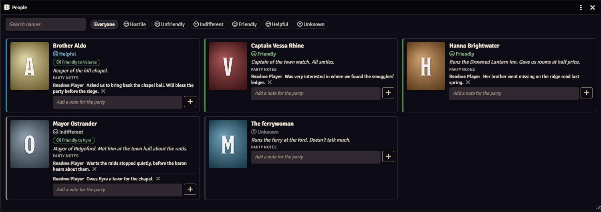

# PF2e NPC Attitudes

Tracks how the people the party has met feel about them. The GM sets each NPC's attitude, from Hostile to Helpful, and marks who the party has met. Players get a read-only People window with portraits, the name they know each NPC by, their attitude and shared party notes.

## What it looks like



**The GM's view.** Each NPC's real attitude and what the players are shown: Captain Rhine is Unfriendly but plays Friendly, and the ferrywoman's name and mood are still unknown. Attitudes toward one character, a public one-line description, and the party's notes.



**The players' People window.** Portraits, the names the party knows, the attitudes they've been shown, and notes the whole party can add to.

## Install

In Foundry, go to **Add-on Modules**, then **Install Module**, and paste this into **Manifest URL**:

```
https://github.com/Sir-Bayard/pf2e-npc-attitudes/releases/latest/download/module.json
```

Foundry's **Update** button then picks up each new release. You can also download `module.zip` from the [latest release](https://github.com/Sir-Bayard/pf2e-npc-attitudes/releases/latest) and unzip it into `Data/modules/pf2e-npc-attitudes`.

Requires Foundry VTT 14 (verified on 14.369) and the Pathfinder 2e system 8.0.0 or later.

Updating keeps attitudes and notes.

## What it does

Tracks how the people the party has met feel about them, using GM Core's attitudes: Hostile, Unfriendly, Indifferent, Friendly and Helpful. The GM sets each NPC's attitude and marks who the party has met. Players get a read-only People window: portrait, the name they know the NPC by, the attitude, a one-line description, and shared party notes they can add to.

## Opening it

Token controls on the left: the address-book icon at the bottom of the list. Macro: `game.modules.get("pf2e-npc-attitudes").api.open()`

## For the GM

- **Mark people as met**: select their tokens and click "Mark selected tokens as met", or right-click an NPC in the Actors sidebar and choose "People: met / not met", or turn off the "Met only" chip in the window and tick Met on a card. Marking from a token whose name differs from the prototype token name fills in "Known as" with the token's name.
- **Chips**: "Met only" hides NPCs the party hasn't met; "Cast" shows only actors your campaign module marks as Cast: list that module's id in the "Cast flag scopes" setting (empty by default), and any actor with `flags.<id>.cast` set counts. Both are remembered in this browser.
- Attitude is the NPC's real attitude. "Players see" is what the party is shown: the same, a different attitude (someone hiding how they feel), or Unknown. The GM sees both.
- Setting Hostile when the NPC has tokens on the current scene that aren't Hostile asks whether to set those tokens' disposition to Hostile; Friendly or Helpful asks the same for Friendly. Nothing changes unless you say yes.
- "Toward each character" sets how the NPC feels about one character in particular, when it differs from their general attitude: Unfriendly to Valeros but Helpful to Kyra. Leave a character on "As above" to use the general attitude. Players see these as small tags under the attitude, but only while "Players see" is "The same"; an NPC hiding how they feel shows the players nothing about individual characters either.
- The one-line description is shown to players. Use it for who they are and where the party met them.
- Click a portrait to open the NPC's sheet.

## Names and portraits

Players see the "Known as" name; when it is empty, the actor's prototype token name. The actor's own name is shown to the GM only, in small grey type beside it. Players see the "Portrait" image; when it is empty, the prototype token image, and failing that the actor image. Pick one with the image button or type a path. The image's alt text is the known name, so a file named after the real person doesn't show up as a tooltip.

Macros: `api.setKnownAs(actor, "Brother Anselm")` sets the name players see; `api.reveal(actor)` sets it to the actor's real name.

## Announcements

Nothing is posted to chat on its own. The Announce button on a GM card posts what the players see of that NPC (name, attitude, per-character tags, the one-line description). The "Announce to" setting says where it goes: everyone, whispered to the GM, or nobody (the button then does nothing).

## Party notes

Notes are a list of short entries, each with who wrote it, newest last. Any player can add an entry and remove their own; the GM can remove any. A player's entry is saved through the GM's client, so a GM has to be logged in. At most 40 entries or 4000 characters per NPC; the oldest go first. A note written with 0.2.1 or earlier appears as the first entry, with no author.

## What players can read

The real attitude and the "Players see" value live in the actor's flags, which Foundry sends to every client. The window and the API only show players the shown attitude, but a player who reads the actor in the console can see the real one. Treat "Players see" as a courtesy, not a secret.

## Where the data lives

On each NPC actor, in `flags.pf2e-npc-attitudes.npc`. Unlinked NPCs keep it on the actor in the sidebar, not on individual tokens.

## Changes

See [CHANGELOG.md](CHANGELOG.md).

## How it was made

This module was written with Claude, Anthropic's AI assistant, directed and tested by its author at a real table. It is shared as is, for free.

## Problems and suggestions

Open an [issue](https://github.com/Sir-Bayard/pf2e-npc-attitudes/issues).

## License

[MIT](LICENSE). Copyright (c) 2026 Sir Bayard.

## Paizo Community Use

PF2e NPC Attitudes uses trademarks and/or copyrights owned by Paizo Inc., used under Paizo's Community Use Policy ([paizo.com/licenses/communityuse](https://paizo.com/licenses/communityuse)). We are expressly prohibited from charging you to use or access this content. PF2e NPC Attitudes is not published, endorsed, or specifically approved by Paizo. For more information about Paizo Inc. and Paizo products, visit [paizo.com](https://paizo.com).
